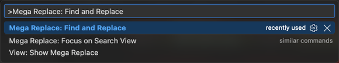
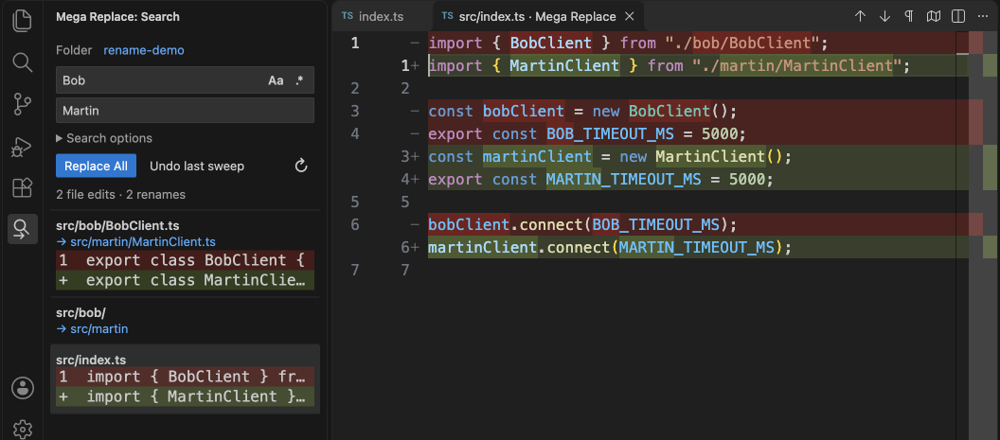

# Mega Find and Replace

Rename files, folders, and the text that refers to them in one pass. Suppose `Bob` is becoming `Martin` in a project. Enter those two names once and preview the whole change.

| Where | Before | After |
| --- | --- | --- |
| Folder | `./src/bob/` | `./src/martin/` |
| File | `./src/bob/BobClient.ts` | `./src/martin/MartinClient.ts` |
| Import in `src/index.ts` | `"./bob/BobClient"` | `"./martin/MartinClient"` |
| Code | `bobClient.connect(BOB_TIMEOUT_MS)` | `martinClient.connect(MARTIN_TIMEOUT_MS)` |

The same rule works for multiword names. Rename `JobQueue` to `WorkerPool` and `job_queue_size` becomes `worker_pool_size`, while `job-queue` becomes `worker-pool`.

The extension and CLI run on **macOS and Linux** with **Python 3.9+** available as `python3`. Linux also requires GNU `cp` and `renameat2`.

## In VS Code

**1. Open Mega Replace.** With your project open, press **Cmd+Shift+P** on macOS or **Ctrl+Shift+P** on Linux to open the Command Palette. Run **Mega Replace: Find and Replace**. [Install from the Marketplace](https://marketplace.visualstudio.com/items?itemName=alexdoesitllc.mega-find-and-replace) · [Download a VSIX](https://github.com/Alex-Does-IT/mega-find-and-replace/releases/latest)



**2. Preview the rename.** The panel starts in your workspace folder. To narrow the scope, right-click a folder in Explorer and choose **Mega Replace in Folder…**. To rename `./src/bob/` itself, select `src` or the project root. Enter `Bob` in **Search** and `Martin` in **Replace**. Click an edited file to see its diff. Here, `src/index.ts` shows the import and identifiers changing together.



**3. Apply or undo.** Choose **Replace All** when the diff looks right. **Undo last sweep** restores the paths and text in that scope, even after you reopen VS Code.

## From the terminal

Clone this repo and preview the same rename in a neighboring project.

```sh
./mega-rename preview ../my-project Bob Martin --diff
```

When the diff looks right, run `./mega-rename apply ../my-project Bob Martin`. To roll it back, run `./mega-rename undo ../my-project`.

By default, `Bob` matches the capitalized word in `getBob` and skips `bobcat`. Add `--substring` if you want `martincat` too. Use `--literal` for exact text or `--regex` for Python patterns with captures such as `$1`. See `./mega-rename preview --help` for matching and exclusion options.

## What a sweep touches

- The scan respects Git ignore rules and skips symlinks and common dependency folders.
- Text matches include imports, strings, comments, and docs. By default, binary files and files over 16 MiB can still be renamed, but their contents are skipped.
- If two filenames would collide, the sweep stops before writing. Originals are saved in `.mega-rename/` inside the selected folder. Keep it for undo. If an edited file changes again, undo reports the conflict.

## Local development

Run `python3 -m unittest -v` for the CLI tests. To try extension changes, open this checkout in VS Code and press **F5**. Open a disposable folder in the **Extension Development Host** and try a rename and undo. After editing the source, run **Developer: Reload Window** in that window.

Created by **Alex Does IT LLC**. [MIT License](LICENSE)
